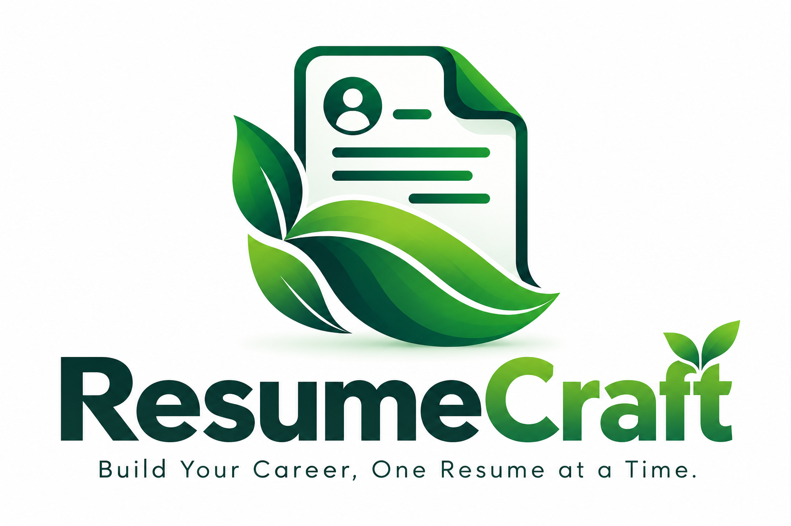

# ✨ ResumeCraft

<div align="center">



### 🌿 Build. Preview. Download. Get hired. 🚀

A modern, full-stack resume builder that helps you create professional resumes, preview PDFs, download them, and send them by email.

[🌐 Live Demo](https://resume-craft-pink.vercel.app) · [💻 GitHub Repository](https://github.com/mohitkpani/resume-craft) · [⚙️ Backend API](https://resume-craft-ghx8.onrender.com)


</div>

---

## 🌈 About ResumeCraft

**ResumeCraft** is a full-stack web application designed to make resume creation simple and convenient. Enter your details, preview your backend-generated PDF, download it, or request delivery by email.

With a clean green-and-mint interface, responsive layout, and light/dark themes, ResumeCraft provides a streamlined resume-building experience.

## ✨ Features

| Feature                 | Description                                                        |
| ----------------------- | ------------------------------------------------------------------ |
| 👤 Personal Information | Add your name, contact details, job title, and location.           |
| 📝 Professional Summary | Write a concise introduction for your resume.                      |
| 🛠️ Skills               | Showcase relevant technical and professional skills.               |
| 🎓 Education            | Add multiple education entries.                                    |
| 💼 Work Experience      | Describe roles, responsibilities, and achievements.                |
| 🚀 Projects             | Highlight your projects and contributions.                         |
| 🏆 Certifications       | Include certifications and credentials.                            |
| 🌍 Languages            | Add languages and proficiency levels.                              |
| 👀 Live PDF Preview     | Preview the PDF generated by the backend.                          |
| 📥 Download PDF         | Download your generated resume.                                    |
| ✉️ Email PDF            | Request that your resume be sent to a recipient by email.          |
| 🎨 Light & Dark Mode    | Switch between visual themes.                                      |
| 📱 Responsive Design    | Use the application on desktop and mobile devices.                 |
| 🔔 Smart Notifications  | Notifications disappear after 3 seconds or can be closed manually. |

## 🧰 Tech Stack

### Frontend

- React
- Vite
- JavaScript
- CSS
- Lucide React icons

### Backend

- Java 21
- Spring Boot
- Maven
- REST APIs
- Docker

### Deployment & Tools

- Git and GitHub
- Vercel — frontend hosting
- Render — backend hosting

## 🌐 Live Application

| Service        | URL                                                                      |
| -------------- | ------------------------------------------------------------------------ |
| 🚀 Frontend    | [resume-craft-pink.vercel.app](https://resume-craft-pink.vercel.app)     |
| ⚙️ Backend     | [resume-craft-ghx8.onrender.com](https://resume-craft-ghx8.onrender.com) |
| 💻 Source Code | [mohitkpani/resume-craft](https://github.com/mohitkpani/resume-craft)    |

> **Note:** The backend root URL may not display a webpage because the API is intended to serve application endpoints.

## 🖥️ Run Locally

### Prerequisites

Install the following:

- [Node.js and npm](https://nodejs.org/)
- Java 21
- Git

### 1. Clone the repository

```bash
git clone https://github.com/mohitkpani/resume-craft.git
cd resume-craft
```

### 2. Start the backend

The Spring Boot project is located in `resumecraft-backend/resumecraft-backend`.

**Windows PowerShell:**

```powershell
cd resumecraft-backend/resumecraft-backend
$env:SENDLIBERTY_API_KEY="YOUR_API_KEY"
.\mvnw.cmd spring-boot:run
```

**macOS / Linux:**

```bash
cd resumecraft-backend/resumecraft-backend
export SENDLIBERTY_API_KEY="YOUR_API_KEY"
./mvnw spring-boot:run
```

Replace `YOUR_API_KEY` with your own SendLiberty API key. Keep the key private.

### 3. Start the frontend

Open a second terminal from the repository root:

```bash
cd smart-resume-builder
npm install
npm run dev
```

Vite will show the local development URL, usually `http://localhost:5173`.

### 4. Build the frontend

From the `smart-resume-builder` directory:

```bash
npm run build
```

The production build is created in the `dist` directory.

## 🔐 Environment Variables & Security

The backend reads the SendLiberty API key from an environment variable:

```properties
sendliberty.api.key=${SENDLIBERTY_API_KEY}
```

Configure `SENDLIBERTY_API_KEY` in your local environment or backend hosting dashboard.

- Never commit API keys, passwords, or email credentials.
- Never put private backend secrets in frontend code.
- Keep `.env` files out of Git.
- Configure CORS to allow your deployed frontend origin.

## 📂 Project Structure

```text
resume-craft/
├── resumecraft-backend/
│   └── resumecraft-backend/
│       ├── src/
│       ├── .mvn/
│       ├── Dockerfile
│       ├── mvnw
│       ├── mvnw.cmd
│       └── pom.xml
├── smart-resume-builder/
│   ├── public/
│   │   ├── resumecraft-logo.png
│   │   └── favicon.svg
│   ├── src/
│   │   ├── App.jsx
│   │   ├── App.css
│   │   └── main.jsx
│   ├── package.json
│   └── vite.config.js
└── README.md
```

## 🔄 How It Works

1. Enter your resume details in the React interface.
2. The frontend sends your resume data to the Spring Boot backend.
3. The backend generates a PDF and returns it for preview.
4. Download the PDF or enter a recipient email address to request email delivery.
5. Success and error notifications provide feedback.

## 🛠️ Troubleshooting

- **PDF preview or download fails:** Check the Render service status and browser console.
- **CORS error:** Verify that the deployed Vercel origin is allowed in the backend CORS configuration.
- **Email sending fails:** Confirm that `SENDLIBERTY_API_KEY` is configured correctly in Render.
- **Local requests fail:** Check the API URL and make sure the backend is running.
- **First request is slow:** A hosted backend may take time to wake up after inactivity.

## 🗺️ Future Improvements

- [ ] Multiple resume templates
- [ ] Resume customization options
- [ ] User accounts and saved resumes
- [ ] Additional export options
- [ ] Automated testing and accessibility improvements

## 🤝 Contributing

Contributions and suggestions are welcome!

1. Fork this repository.
2. Create a feature branch.
3. Make your changes and test them.
4. Open a pull request.

## 📄 License

No license has been specified yet. Add a `LICENSE` file if you decide to distribute the project under an open-source license.

---

<div align="center">

### 💚 Your story. Your skills. Your next opportunity.

**Built with care using React and Spring Boot.**

[⭐ Explore ResumeCraft](https://resume-craft-pink.vercel.app)

</div>
